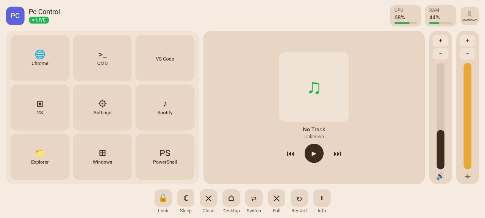

# 🖥️ PC Remote Control

**PC Remote Control** is a lightweight desktop application built with Python and FastAPI that allows you to control your Windows PC effortlessly from your smartphone over a local Wi-Fi network.

---

## 📸 Interface Preview

<div align="center">
  
</div>

---

## ✨ Features

* **📱 Instant QR Code Pairing:** Scan the generated QR code on application startup to access the dashboard instantly from your mobile device.
* **🔊 Audio & Brightness Control:** Adjust Windows master volume and monitor brightness in real-time.
* **🎵 Media Controls:** Play, pause, skip tracks, and view album art/cover status for Spotify, YouTube, and system media players.
* **🚀 Process & App Launcher:** Launch configured applications or manage background processes remotely.
* **🌙 Dark Mode UI:** Modern, fast, and fully responsive web interface designed for all mobile devices.

---

## 🚀 Quick Start for Windows (No Setup Required)

You do not need Python or any dependencies installed on your computer:

1. Download **`PCRemoteControl.exe`** from the [Releases](../../releases) section.
2. Double-click the `.exe` file to launch the control window.
3. Scan the displayed **QR Code** with your smartphone camera or open the printed local URL.

> **Note:** If Windows SmartScreen displays a warning, click **More info** ➔ **Run anyway**.

---

## 🛠️ For Developers (Running from Source Code)

If you want to modify or rebuild the project locally:

### 1. Clone the repository
```bash
git clone https://github.com/RuslanSharifov/pc-controller.git
cd pc-controller

```

### 2. Set up virtual environment

```bash
python -m venv .venv
call .venv\Scripts\activate.bat

```

### 3. Install dependencies

```bash
pip install -r requirements.txt

```

### 4. Run the application

```bash
python gui_launcher.py

```

---

## 📦 Rebuilding the Executable (PyInstaller)

To compile the project into a single executable `.exe` file after making changes:

```cmd
rmdir /s /q build dist
pyinstaller --noconsole --onefile --icon=icon.ico --add-data "static;static" --add-data "templates;templates" --hidden-import=webview --hidden-import=uvicorn --hidden-import=qrcode --hidden-import=PIL --hidden-import=qrcode.image.pil gui_launcher.py

```

---

## 🛠️ Tech Stack

* **Backend:** Python 3, FastAPI, Uvicorn, Pycaw, WinRT / WinSDK
* **GUI / Launcher:** PyWebView, PyQRCode, Pillow
* **Frontend:** HTML5, Modern CSS (Glassmorphism / Dark Slate), JavaScript (Fetch API)

---

Developed with ❤️ by **Ruslan**

```

---

### Skrinşotu Layihəyə Əlavə Etmək Üçün:
1. Layihə qovluğunda **`docs`** adlı yeni papka açın.
2. İnterfeysin 16:9 ölçüdə (məsələn, 1280x720) çəkilmiş şəklini **`preview.png`** adı ilə həmin papkaya atın (`docs/preview.png`).

```